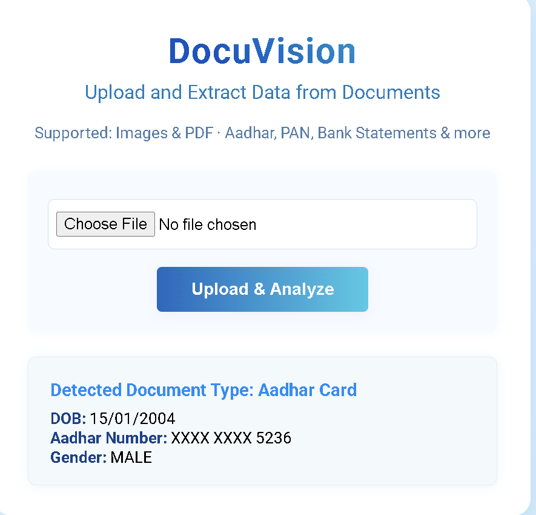
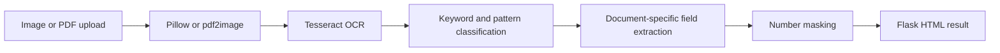

# DocuVision

**Turn a document image or PDF into a structured field summary.**

DocuVision is a Flask application that reads uploaded documents with Tesseract OCR, classifies their text using keywords and patterns, and extracts document-specific fields for display.

[Demo](#demo) · [Setup](#run-locally) · [Architecture](#architecture) · [Implementation](app.py)

## Why this project exists

Copying information from scans is repetitive. This project explores a small, understandable OCR workflow for reviewing common identity and financial documents. It is useful as a learning project and a starting point for testing extraction rules against sample documents.

## Capabilities

- Accept JPEG, PNG, and PDF uploads.
- Recognize Aadhaar, PAN, and bank-statement patterns, with an “Others” fallback.
- Extract fields using regular expressions and document-specific rules.
- Mask extracted Aadhaar values and provide a helper for bank-account masking.

Classification is rule based; this repository does not implement a trained document classifier or an LLM pipeline. OCR and extraction can miss or misread fields, so review the output against the source document.

## Demo



## Run locally

Install Python, the **Tesseract OCR executable**, and **Poppler** for PDF conversion. Python dependencies alone do not install these executables. `app.py` currently assigns a Windows-specific path to `pytesseract.pytesseract.tesseract_cmd`. Change that assignment to your installed executable, or remove it when Tesseract is available on your system path. Configure Poppler for your operating system as well.

```bash
python -m venv .venv
source .venv/bin/activate
pip install -r requirements.txt
python app.py
```

On Windows, activate the environment with `.venv\Scripts\activate`. Open `http://127.0.0.1:5000/`, upload a clear sample document, and compare the extracted fields with the original.

The included entry point enables Flask debug mode for local development. It is not a deployment configuration.

## Architecture



The request handler processes uploaded bytes without a database. Field masking does not redact the original document, and the current development code prints OCR text to the server console. Bank-account display also needs the extractor and template field names aligned: the current names differ, so those fields are not shown by the template.

| File | Role |
|---|---|
| [`app.py`](app.py) | Upload handling, OCR, classification, extraction, and masking |
| [`templates/upload.html`](templates/upload.html) | Upload form and result presentation |
| [`requirements.txt`](requirements.txt) | Python dependencies |

## Extending extraction

Add a document rule in `classify_doc_type`, then update `extract_fields` for that document type. Use representative sample text to check both successful extraction and missing-field behavior. Prefer synthetic documents for examples and issue reports.
